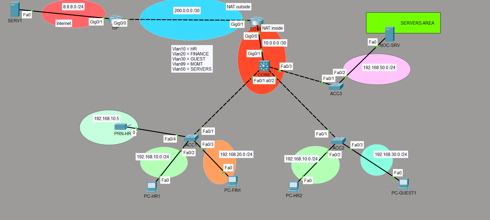

# TechCorp Lebanon — Enterprise Network Lab (Cisco Packet Tracer)

A small-company network built from scratch in Cisco Packet Tracer, in 10 stages: switching, routing, internet access, security hardening, network services and hands-on troubleshooting.

Every stage was built, verified with show commands and pings, and documented with screenshots. The real bugs I hit along the way are logged below, with their cause and fix.

---

## Skills demonstrated

| Area | What I configured |
|---|---|
| **Switching** | VLANs, 802.1Q trunks, access ports, native VLAN, parking VLAN |
| **Routing** | Inter-VLAN routing (SVIs on a Layer 3 switch), static/default routes, OSPF (single area) |
| **Internet edge** | NAT/PAT (overload) on the edge router, simulated ISP |
| **Services** | DHCP (pools + exclusions), DNS, NTP, Syslog, SNMP v2c |
| **Security** | Extended ACL (guest isolation), SSH v2 only, port security (sticky MAC), OSPF passive interfaces, hashed secrets, login banner |
| **Operations** | Central logging, time sync, SNMP polling, NOC-style troubleshooting tickets |

---

## Topology

| Device | Model | Role |
|---|---|---|
| CORE | Cisco 3560 (L3 switch) | Inter-VLAN routing, DHCP server, Guest ACL, OSPF |
| ACC1, ACC2 | Cisco 2960 | User access switches |
| ACC3 | Cisco 2960 | Server access switch |
| EDGE | Cisco 2911 | Internet edge router, NAT/PAT, OSPF |
| ISP | Cisco 2911 | Simulated ISP (no routes to private networks) |
| SERV1 | Server | Simulated internet server + DNS (8.8.8.8) |
| NOC-SRV | Server | Internal NTP, Syslog and SNMP manager |
| PRN-HR | Printer | HR network printer |

## Addressing plan

| VLAN | Name | Network | Gateway |
|---|---|---|---|
| 10 | HR | 192.168.10.0/24 | 192.168.10.1 |
| 20 | FINANCE | 192.168.20.0/24 | 192.168.20.1 |
| 30 | GUEST | 192.168.30.0/24 | 192.168.30.1 |
| 50 | SERVERS | 192.168.50.0/24 | 192.168.50.1 |
| 99 | MGMT | 192.168.99.0/24 | 192.168.99.1 |
| 999 | PARKING | — | unused ports, shut down |
| 1000 | NATIVE | — | native VLAN on all trunks, no ports |

| Link / host | Address |
|---|---|
| CORE Gig0/1 ↔ EDGE Gig0/0 | 10.0.0.1 / 10.0.0.2 (/30) |
| EDGE Gig0/1 ↔ ISP Gig0/0 | 200.0.0.1 / 200.0.0.2 (/30) |
| ISP Gig0/1 ↔ SERV1 | 8.8.8.1 / 8.8.8.8 (/24) |
| Switch management (VLAN 99) | ACC1 .2 · ACC2 .3 · ACC3 .4 |
| NOC-SRV | 192.168.50.10 |
| PRN-HR | 192.168.10.5 (static, inside the DHCP-excluded range) |

---

## What I built, stage by stage

| Stage | Topic | Key result |
|---|---|---|
| 1 | VLANs + trunking | 4 VLANs across 3 switches; HR1 ↔ HR2 works across two trunks, HR ↔ Finance blocked (no routing yet) |
| 2 | Inter-VLAN routing | SVIs on CORE; TTL drops 128 → 127, proving traffic is routed |
| 3 | DHCP | One pool per VLAN on CORE, first 10 addresses excluded |
| 4 | Internet + PAT | All VLANs share one public IP (200.0.0.1); the ISP has no private routes, so NAT is proven to do the work |
| 5 | Guest isolation ACL | Guest reaches the internet only; HR, Finance, management and servers are blocked (match counters verified) |
| 6 | OSPF | Replaced the static return routes with OSPF between CORE and EDGE |
| 7 | Secure management | Management IPs on VLAN 99, SSH v2 only (Telnet refused), local users, hashed secrets, banner |
| 8 | Access-layer hardening | Port security (rogue device test → err-disabled), unused ports parked + shut, native VLAN 1000, OSPF passive interfaces |
| 9 | Network services | Server VLAN + switch, DNS, NTP, Syslog, SNMP, network printer |
| 10 | Break and fix | Three NOC-style tickets diagnosed and resolved (below) |

Each `stageXX` folder contains that stage's `.pkt` snapshot and its screenshots.

### Key screenshots

| What it proves | Screenshot |
|---|---|
| Trunks carry only the needed VLANs | [stage01/stage1_trunk_core.png](stage01/stage1_trunk_core.png) |
| Routed between VLANs (TTL 127) | [stage02/stage2_ping_hr1_fin1.png](stage02/stage2_ping_hr1_fin1.png) |
| DHCP leases per VLAN | [stage03/stage3_dhcp_binding_core.png](stage03/stage3_dhcp_binding_core.png) |
| Many hosts behind one public IP (PAT) | [stage04/stage4_nat_translations.png](stage04/stage4_nat_translations.png) |
| ISP has no private routes | [stage04/stage4_ip_route_isp.png](stage04/stage4_ip_route_isp.png) |
| Guest ACL match counters | [stage05/stage5_acl_counters.png](stage05/stage5_acl_counters.png) |
| OSPF replaced static routes | [stage06/stage6_route_edge_after.png](stage06/stage6_route_edge_after.png) |
| SSH works, Telnet refused | [stage07/stage7_ssh_core_success.png](stage07/stage7_ssh_core_success.png) · [stage07/stage7_telnet_refused.png](stage07/stage7_telnet_refused.png) |
| Rogue device caught by port security | [stage08/stage8_rogue_errdisabled.png](stage08/stage8_rogue_errdisabled.png) |
| Central syslog from every device | [stage09/stage9_syslog.png](stage09/stage9_syslog.png) |
| SNMP polling from the NOC server | [stage09/stage9_snmp_sysname.png](stage09/stage9_snmp_sysname.png) |
| Ticket 2 detected in syslog | [stage10/ticket2/stage10_t2_syslog_ospf_down.png](stage10/ticket2/stage10_t2_syslog_ospf_down.png) |

---

## Troubleshooting tickets (Stage 10)

**Method used for every ticket:** symptom → scope → isolate → root cause → fix + verify.

### Ticket 1: one HR PC has no network
- **Symptom:** PC-HR2 couldn't get a DHCP address.
- **Scope:** only HR2. HR1 (same VLAN, other switch) and GUEST1 (same switch, other VLAN) worked.
- **Isolate:** followed the DHCP path; `show interfaces trunk` on CORE showed VLAN 10 missing from the trunk to ACC2.
- **Cause:** VLAN 10 had been removed from the CORE Fa0/2 allowed list.
- **Fix:** `switchport trunk allowed vlan add 10`. HR2 got an address and reached the internet.

### Ticket 2: the whole company lost the internet
- **Symptom:** no internet in any VLAN; internal traffic and printing still worked.
- **Scope:** company-wide, internet only, so the fault is between CORE and the outside.
- **Isolate:** Syslog showed the OSPF adjacency going down (CORE: *interface down*; EDGE: *dead timer expired* ~36 s later). EDGE had no OSPF neighbour and no routes back to the VLANs. `show ip protocols` on CORE listed Gig0/1 as passive.
- **Cause:** `passive-interface g0/1` stopped OSPF hellos on the only CORE–EDGE link. Outbound traffic still left via the default route, but EDGE dropped the replies.
- **Fix:** `no passive-interface g0/1`. The adjacency returned to FULL and the routes came back.

### Ticket 3: IT can't manage ACC1 remotely
- **Symptom:** SSH to ACC1 was "closed by foreign host"; ping worked.
- **Scope:** only ACC1; SSH to the other switches worked.
- **Isolate:** consoled into ACC1 and compared the VTY config with ACC2; Telnet to ACC1 was accepted.
- **Cause:** VTY lines set to `transport input telnet`. SSH was blocked, and admin credentials could cross the network in plain text.
- **Fix:** `transport input ssh`. Recommended a password change and reviewed Syslog for the config change.

---

## Bugs I hit and fixed

| Problem | Cause | Fix |
|---|---|---|
| Device prompt still `Switch` / `Router` | Hostname not set (CORE, ISP, ACC3) | `hostname` on every device |
| Access uplinks trunking anyway | DTP auto-negotiation | Hard-coded `switchport mode trunk` |
| Only VLAN 99 crossed the trunks | `switchport trunk allowed vlan` replaces the whole list | Full list in one command, or `allowed vlan add` |
| Internet ping failed after NAT | NAT rule translated to the inside interface (10.0.0.2) | Translate to the outside interface (g0/1) |
| ACL not shown in the config | Packet Tracer display bug | Verified by behaviour + `show access-lists` counters |
| Guest reached HR again later | Packet Tracer dropped the ACL binding after reopening the file | Reapplied; re-test security controls after every change |
| OSPF routes didn't appear | Static routes (AD 1) beat OSPF (AD 110) | Removed the static routes |
| SSH closed right after the password | `login` instead of `login local` on VTY lines | `login local` |
| Rogue laptop blocked instantly | Port security: its first frame (DHCP) was a violation | err-disabled recovery: `shutdown` / `no shutdown` |
| Server switch trunk carried every VLAN | Allowed list left at default (1–1005); server port left in VLAN 1 | `allowed vlan 50,99`; port moved to VLAN 50 |
| New server had no internet or DNS | New subnet missing from the NAT ACL | Added 192.168.50.0 to the NAT ACL |
| Router logs timestamped 1993 | EDGE skipped when deploying NTP and Syslog | Added NTP; verify every device after a rollout |
| Two SNMP communities on a switch | Typo left behind (`techRO` + `TechRO`) | Removed the extra community |

---

## Lessons learned

- **Routing is two-way.** A request getting out doesn't mean the reply can get back (NAT, return routes).
- **Test the IP before the name.** If the IP works and the name doesn't, it's DNS; if both fail, it's the network.
- **Verify by behaviour and counters**, not one show command.
- **A new subnet touches every policy that lists subnets:** trunks, routing, NAT, ACLs.
- **After any rollout, check every device.** One missed router broke log correlation.
- **Configure first, enable last:** assign the VLAN and port security before `no shutdown`.

---

## How to open

1. Install [Cisco Packet Tracer](https://www.netacad.com/cisco-packet-tracer) (free with a NetAcad account).
2. Open `stage10/TechCorp_stage10.pkt` for the final network, or any earlier stage to see the build progress.
3. Lab credentials: user `admin` (lab only, not reused anywhere).

> **Packet Tracer note:** after reopening the file, reapply the Guest ACL on CORE (`interface vlan 30` → `ip access-group GUEST_ISO in`); Packet Tracer doesn't keep that binding.

---

*Built by Ali as a hands-on review of CCNA-level networking and security, aimed at IT support, NOC and SOC roles.*
